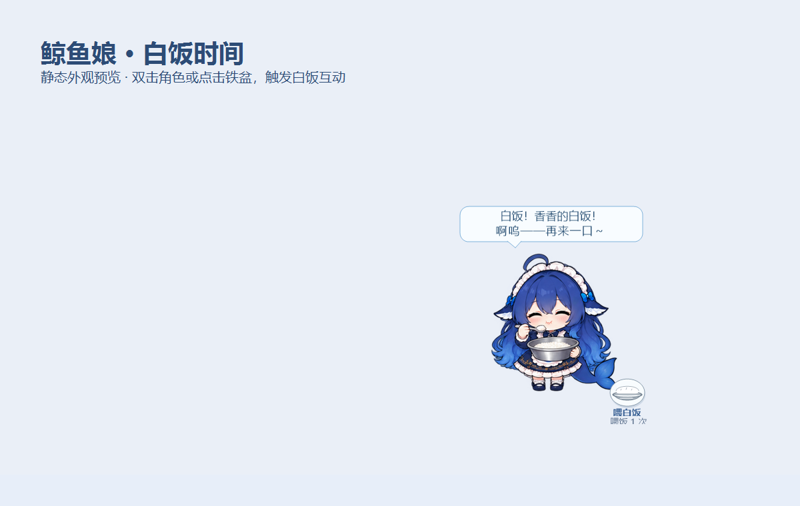

# DeepSeek 鲸鱼娘桌宠 · Windows

把爱吃白饭的鲸鱼娘放到桌面上：端着铁盆讨饭、啊呜吃饭、吃饱庆祝，偶尔散步、抱尾巴、犯困。

**独立 Windows 程序，下载后直接运行；关闭 Codex 也能继续陪着你。**

[下载最新版本](https://github.com/whh062413/DeepseekWhalegirl-pet-Windows/releases/latest) · [查看全部动作](previews/全部动作预览.gif) · [参考来源](source/REFERENCES.md)


## 开始使用

1. 打开 [Releases](https://github.com/whh062413/DeepseekWhalegirl-pet-Windows/releases/latest)，下载 `鲸鱼娘桌宠.exe`，或下载运行包并解压。
2. 双击 `鲸鱼娘桌宠.exe`。
3. 双击鲸鱼娘，或点击她旁边的 **「喂白饭」** 铁盆按钮，开饭！

目前支持 Windows，使用 .NET Framework 4.x。运行时无需 Codex、Python、Node.js、API Key 或网络连接，动画素材已包含在 EXE 中。

## 和她互动

| 操作 | 效果 |
| --- | --- |
| 单击角色 | 打招呼、害羞、抱尾巴等随机回应 |
| 双击角色 / 点击「喂白饭」 | 用铁盆喂白饭，吃完后开心庆祝 |
| 按住鼠标左键拖动 | 调整桌宠位置 |
| 右键角色 | 打开动作相册、小剧场、大小及其他设置 |
| 双击系统托盘图标 | 隐藏或显示桌宠 |
| 右键 → 退出 | 关闭程序 |

- **17 种动作、68 帧动画**：待机、走路、吃白饭、开心、睡觉、思考、好奇、惊讶、鼓脸、害羞、伸懒腰、抱尾巴、端盆讨饭、吃饱庆祝、尾巴藏饭、醒来、鞠躬。
- **6 段小剧场**：报到啦、白饭时间、还想再来一碗、偷藏白饭被发现、起床开饭、今天也辛苦了。
- 支持自动散步、偶尔卖萌、睡觉与唤醒，以及小 / 中 / 大三种尺寸。
- 设置保存在 `%LOCALAPPDATA%\DeepSeekWhalePet`，程序不会设置开机自启。

<details>
<summary>展开查看端盆讨饭与桌面外观</summary>




</details>

## 从源码构建

在 Windows 上安装 .NET Framework 对应的 C# 编译器后，从仓库根目录运行：

```powershell
powershell -ExecutionPolicy Bypass -File .\source\重新编译.ps1
```

生成文件：`dist\鲸鱼娘桌宠.exe`。重新构建前请先退出已运行的桌宠。

```text
DeepseekWhalegirl-pet-Windows/
├── README.md
├── source/       # C# 源码、构建脚本、内嵌素材及参考记录
├── previews/     # GIF 与截图
└── .gitignore
```

`dist/` 为本地构建输出，不纳入版本控制。EXE 和运行包通过 Releases 提供。素材结构与诊断选项见 [源码说明](source/README.md)。

## 角色与参考

这是 **DeepSeek 鲸鱼娘的非官方同人桌宠**，与 DeepSeek 官方无关联。角色表现参考用户提供的三视图、表情图，以及 B 站 UP 主 **冬冰** 的 [《AI 中转站公寓》系列](https://www.bilibili.com/video/BV1eMeS6SETU/)。

本项目动画素材由 ImageGen 根据上述参考生成，并整理为桌宠动作帧。参考来源和生成记录见 [REFERENCES.md](source/REFERENCES.md)；美术提示词保存在 `source/art/`。

## English quick start

An unofficial DeepSeek Whale Girl desktop pet for **Windows**. She loves plain rice served in a metal basin, with 17 actions, 68 animation frames, and 6 mini-scenes.

Download `鲸鱼娘桌宠.exe` from [Releases](https://github.com/whh062413/DeepseekWhalegirl-pet-Windows/releases/latest) and run it. Double-click the character or click the rice button to feed her; drag with the left mouse button to move her; right-click for actions, scenes, sizes, sleep, and exit. Double-click the tray icon to show or hide her.

The application runs offline on Windows with .NET Framework 4.x. It needs no Codex, Python, Node.js, API key, or separate artwork files. To build from the repository root, run the PowerShell command above; the output is `dist\鲸鱼娘桌宠.exe`.

This is a fan project with no official DeepSeek affiliation. Artwork was generated with ImageGen using the supplied character references and 冬冰’s [Bilibili series](https://www.bilibili.com/video/BV1eMeS6SETU/). See [references](source/REFERENCES.md) for provenance.
